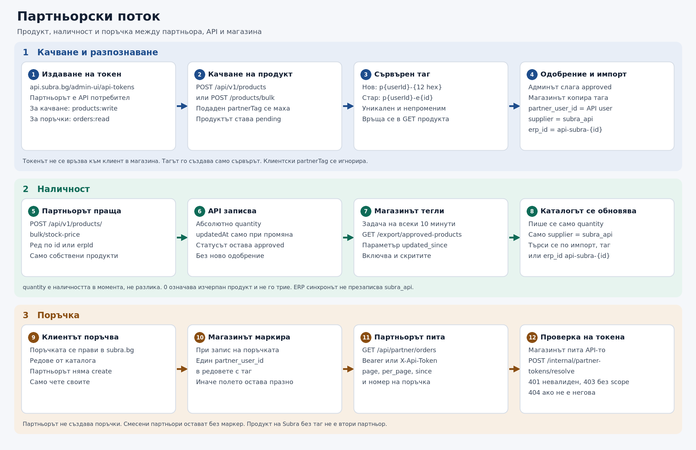

# Subra Products API - Ръководство за интеграция

[English](README.en.md)

> **Версия:** 1.1  
> **Последна актуализация:** 29 октомври 2026

---

## Съдържание

1. [Бърз старт](#1-бърз-старт)
2. [Настройка с Postman](#2-настройка-с-postman)
3. [Удостоверяване](#3-удостоверяване)
4. [Работен процес (Workflow)](#4-работен-процес-workflow)
5. [Категории](#5-категории)
6. [API Endpoints](#6-api-endpoints)
   - [Създаване на продукт](#61-създаване-на-продукт)
   - [Обновяване на продукт](#62-обновяване-на-продукт)
   - [Изтриване на продукт](#63-изтриване-на-продукт)
   - [Получаване на продукт](#64-получаване-на-продукт)
   - [Списък с продукти](#65-списък-с-продукти)
   - [Масови операции](#66-масови-операции-bulk)
   - [Подавания за преглед](#67-подавания-за-преглед)
   - [Одобрен каталог](#68-одобрен-каталог)
   - [Поръчки на партньора](#69-поръчки-на-партньора)
7. [Полета на продукта](#7-полета-на-продукта)
8. [Обработка на грешки](#8-обработка-на-грешки)
9. [Ограничения и правила](#9-ограничения-и-правила)
10. [Примери с cURL](#10-примери-с-curl)
11. [FAQ](#11-faq)
12. [Поддръжка](#12-поддръжка)

---

## 1. Бърз старт

### 1.1 Какво е Subra Products API

REST API за добавяне и управление на продукти в системата на Subra. API-то поддържа:
- Създаване/четене/обновяване/изтриване на продукти (CRUD)
- Списък и статус само на продуктите на текущия клиент
- Подавания за преглед и статистика по статус
- Масови операции (bulk create/update)
- Бързо обновяване на цени и наличности, без ново одобрение
- Проследяване на поръчките, направени в магазина subra.bg
- Експорт на одобрения каталог
- Идемпотентност при създаване

### 1.2 Base URLs

| Сервис | URL |
|--------|-----|
| Основно API | `https://api.subra.bg` |
| Категории | `https://id.subra.bg/categories` |

### 1.3 Токени

Токените се получават от администратор на системата. Всеки токен носи конкретни права (`GET:/api/v1/products`, `POST:/api/v1/product-submissions` и т.н.). Без съответното право отговорът е `403`.

- `main_api_token` — продукти и подавания на `api.subra.bg`
- `approved_products_key` — само `GET /api/v1/approved-products` и `GET /export/approved-products`

Категориите на `https://id.subra.bg/categories` са публични и не изискват токен. Няма отделен sandbox: заявките са към тези продукционни адреси. Нов продукт остава `pending`, докато не бъде одобрен.

---

## 2. Настройка с Postman

### 2.1 Инсталация

1. Инсталирайте [Postman](https://www.postman.com/downloads/)
2. Изтеглете файловете от този репозиторий:
   - `Subra-Products-API.postman_collection.json`
   - `Subra-Products-API.postman_environment.json`

### 2.2 Импортиране

1. **Import** → изберете двата `.json` файла
2. Изберете environment **"Subra API Environment"** от dropdown в горния десен ъгъл
3. Кликнете върху очето (👁️) и редактирайте стойностите:
   - `main_api_token` - вашият токен за продукти
   - `approved_products_key` - ключът за одобрения каталог, ако го ползвате

### 2.3 Налични заявки в колекцията

| # | Заявка | Описание |
|---|--------|----------|
| 1 | **Get Categories** | Взема списък с категории |
| 2 | **Get Category By Id** | Детайли за конкретна категория |
| 3 | **List Products** | Списък с продукти (с пагинация) |
| 4 | **Create Product With Full Payload** | Създава продукт с всички полета |
| 5 | **Negative Test - Invalid Category** | Тест с невалидна категория |

> Postman автоматично записва `category_id` и `category_name` от заявка 1 в променливи за заявка 4.

---

## 3. Удостоверяване

Всички заявки изискват Bearer Token в Authorization header:

```http
Authorization: Bearer <your_token>
```

---

## 4. Работен процес (Workflow)

Партньорът качва продукти, поддържа наличността им и чете поръчките, които клиентите вече са направили в магазина. Партньорът не създава поръчки.



### 4.1 Създаване на нов продукт

1. Вземете крайна категория от `GET https://id.subra.bg/categories`.
2. Създайте продукта с `POST /api/v1/products` или `POST /api/v1/products/bulk`.
3. API-то дава уникален `partnerTag` с формат `p{userId}-{12 hex}`. Подаден от клиента таг се игнорира.
4. Продуктът е `pending`, докато администратор го одобри.
5. След одобрение магазинът го импортира и по тага разпознава поръчките.

### 4.2 Обновяване на наличност

Пращайте абсолютната наличност, не разлика спрямо предишната:

```http
POST /api/v1/products/bulk/stock-price
```

`quantity: 0` означава изчерпан продукт и не го изтрива. Статусът остава `approved`. Магазинът прихваща промяната до около 10 минути. За ежедневна синхронизация е достатъчно да пращате променените редове на всеки 10–15 минути.

### 4.3 Четене на поръчки

Поръчките се правят от клиенти в `https://subra.bg`. Партньорът ги чете с токен, който има право `orders:read`:

```http
GET https://subra.bg/api/partner/orders
Authorization: Bearer <main_api_token>
```

Връщат се само поръчки, в които продадените партньорски продукти са на този партньор. Ако в една поръчка има продукти на двама партньори, тя не се маркира и не се връща.

---

## 5. Категории

### 5.1 Получаване на всички категории

```http
GET https://id.subra.bg/categories
```

**Примерен отговор:**
```json
[
  { "id": 3, "name": "Болкоуспокояващи" },
  { "id": 35, "name": "Витамини и минерали" },
  { "id": 87, "name": "Козметика" }
]
```

### 5.2 Получаване на конкретна категория

```http
GET https://id.subra.bg/categories?id={category_id}
```

Продукт може да се запише само в крайна категория (`isLeaf: true`). Ако `categoryId` или някое от `categoryIds` сочи към родителска категория, заявката връща **400**.

---

## 6. API Endpoints

### 6.1 Създаване на продукт

```http
POST /api/v1/products
Content-Type: application/json
Authorization: Bearer <main_api_token>
Idempotency-Key: c3b6d2f1-7b5a-4f8b-9d2a-1f2e3d4c5b6a  # Опционално
```

**Примерен body:**
```json
{
  "title": "Advanced Retinol Serum/ Серум за красива кожа х 30 ml",
  "brand": "Example Brand",
  "categoryId": 35,
  "categoryIds": [35, 87],
  "currencyId": 1,
  "price": "8.66",
  "oldPrice": "12.90",
  "quantity": 56,
  "barcode": "3800123456789",
  "babh": "BG202600123",
  "slug": "advanced-retinol-serum-30ml",
  "text": "Висококачествен серум за красива кожа с ретинол.",
  "leaflet": "Нанасяйте вечер на чисто лице.",
  "searchWords": "ретинол серум кожа грижа",
  "metaTitle": "Advanced Retinol Serum - 30ml",
  "metaKeywords": "ретинол, серум, кожа, грижа",
  "metaDescription": "Висококачествен серум с ретинол за красива кожа.",
  "i18nForeignKey": 1001,
  "i18nLocale": "bg-BG",
  "itemWeight": 0.150,
  "itemHeight": 12.5,
  "itemWidth": 4.2,
  "itemLength": 4.2,
  "itemVolume": 0.22,
  "itemWeightUnit": "kg",
  "itemVolumeUnit": "l",
  "isNew": true,
  "isBestseller": false,
  "isByPrescription": false,
  "inPromotion": true,
  "visibility": 1,
  "activationDate": "2025-03-24T10:00:00+00:00",
  "image1": "https://example.com/product-1.jpg",
  "image2": "https://example.com/product-2.jpg"
}
```

**Успешен отговор (201):**
```json
{
  "id": 12345,
  "title": "Advanced Retinol Serum...",
  "categoryId": 35,
  "price": "8.66",
  "quantity": 56,
  "partnerTag": "p42-a1b2c3d4e5f6",
  "updatedAt": "2026-10-29T14:00:00+00:00"
}
```

Новият продукт чака одобрение. Статусът се чете от `GET /api/v1/product-submissions`. `partnerTag` се генерира от сървъра и не се приема от клиента.

### 6.2 Обновяване на продукт

```http
PATCH /api/v1/products/{id}
Content-Type: application/json
Authorization: Bearer <main_api_token>
```

**Примерен body (само полетата, които се променят):**
```json
{
  "price": "9.99",
  "quantity": 100,
  "inPromotion": true
}
```

**Алтернатива (POST с override):**
```http
POST /api/v1/products/{id}
Content-Type: multipart/form-data
X-HTTP-Method-Override: PATCH
# или _method=PATCH като form поле
```

### 6.3 Изтриване на продукт

```http
DELETE /api/v1/products/{id}
Authorization: Bearer <main_api_token>
```

### 6.4 Получаване на продукт

```http
GET /api/v1/products/{id}
Authorization: Bearer <main_api_token>
Accept: application/ld+json
```

Отговорът съдържа продукта, включително `partnerTag`, `quantity` и `updatedAt`. Статусът на прегледа е в подаванията. Клиентът може да променя и трие само продукт, който самият той е подал.

### 6.5 Списък с продукти

```http
GET /api/v1/products?page=1&itemsPerPage=30
Authorization: Bearer <main_api_token>
Accept: application/ld+json
```

Връща само продуктите, подадени от потребителя на токена. Продуктите са в `hydra:member`, общият брой е в `hydra:totalItems`. Всеки продукт има `partnerTag`.

**Query параметри:**

- `page` — номер на страницата, от 1
- `itemsPerPage` — брой резултати на страница (по подразбиране 30)

### 6.6 Масови операции (Bulk)

#### 6.6.1 Масово създаване

```http
POST /api/v1/products/bulk
Content-Type: application/json
Authorization: Bearer <main_api_token>
```

```json
{
  "items": [
    {
      "title": "Продукт 1",
      "brand": "Example Brand",
      "categoryId": 35,
      "price": "10.00",
      "quantity": 50
    },
    {
      "title": "Продукт 2",
      "categoryId": 87,
      "price": "25.00",
      "barcode": "3800123456790"
    }
  ]
}
```

**Отговор:**
```json
{
  "created": 2,
  "failed": 0,
  "items": [
    { "success": true, "id": 12346, "title": "Продукт 1", "partnerTag": "p42-a1b2c3d4e5f6" },
    { "success": true, "id": 12347, "title": "Продукт 2", "partnerTag": "p42-b7c8d9e0f1a2" }
  ]
}
```

> **Важно:** Поддържа се partial success - ако един продукт се провали, останалите все пак се създават.

#### 6.6.2 Масово обновяване

```http
PATCH /api/v1/products/bulk
Content-Type: application/json
Authorization: Bearer <main_api_token>
```

```json
{
  "items": [
    {
      "id": 12346,
      "price": "11.00",
      "quantity": 60
    },
    {
      "id": 12347,
      "brand": "Example Brand",
      "price": "26.00",
      "inPromotion": true
    }
  ]
}
```

#### 6.6.3 Масово обновяване на цени и наличности

```http
POST /api/v1/products/bulk/stock-price
Content-Type: application/json
Authorization: Bearer <main_api_token>
```

```json
{
  "effectiveAt": "2025-04-01T00:00:00+00:00",
  "items": [
    {
      "id": 12346,
      "price": "9.99",
      "oldPrice": "12.99",
      "quantity": 100,
      "inPromotion": true,
      "visibility": 1
    },
    {
      "id": 12347,
      "price": "29.99",
      "quantity": 0,
      "visibility": 0
    }
  ]
}
```

**Поддържани полета:** `id`, `price`, `oldPrice`, `quantity`, `inPromotion`, `visibility`, `currencyId`. Продуктът се намира само по `id`, върнато от API-то.

`quantity` е абсолютна наличност. `0` означава изчерпан продукт и не го изтрива. Заявката не връща одобрен продукт обратно в `pending`. Магазинът обновява наличността до около 10 минути. Пращайте променените редове на всеки 10–15 минути.

### 6.7 Подавания за преглед

Тези endpoints не са в OpenAPI (`/api/v1/docs`). Токенът трябва да има право за конкретния път, например `GET:/api/v1/product-submissions`. Списъкът и статистиката са само за подаванията на текущия клиент.

#### 6.7.1 Създаване на подаване

```http
POST /api/v1/product-submissions
Content-Type: application/json
Authorization: Bearer <main_api_token>
```

```json
{
  "product": {
    "title": "Тестов продукт",
    "barcode": "3800123456789",
    "price": "10.00",
    "quantity": 50,
    "categoryId": 35
  }
}
```

Ако вече има продукт със същия `barcode`, подаването е корекция на него. Ако за този продукт вече има чакащо подаване, отговорът е `409`.

**Успешен отговор (201):**

```json
{
  "message": "Product submitted for review",
  "submission": {
    "id": 15,
    "status": "pending",
    "submittedAt": "2026-10-26 12:00:00",
    "productId": 12345,
    "title": "Тестов продукт",
    "barcode": "3800123456789",
    "babh": null,
    "isUpdate": false
  }
}
```

#### 6.7.2 Списък с подаванията на клиента

```http
GET /api/v1/product-submissions
Authorization: Bearer <main_api_token>
```

```json
{
  "submissions": [
    {
      "id": 15,
      "status": "changes_requested",
      "submittedAt": "2026-10-26 12:00:00",
      "reviewedAt": "2026-10-26 13:00:00",
      "rejectionReason": null,
      "changeRequest": "Добавете листовка.",
      "product": {
        "id": 12345,
        "title": "Тестов продукт",
        "barcode": "3800123456789",
        "babh": null,
        "price": "10.00",
        "quantity": 50,
        "visibility": 1
      },
      "changes": null,
      "isUpdate": false
    }
  ]
}
```

`rejectionReason` е попълнено при отказ. `changeRequest` е попълнено, когато администраторът иска корекция. `changes` описва разликите при корекция на съществуващ продукт.

#### 6.7.3 Статистика

```http
GET /api/v1/product-submissions/stats
Authorization: Bearer <main_api_token>
```

```json
{
  "stats": {
    "pending": 2,
    "approved": 10,
    "rejected": 1,
    "changes_requested": 1,
    "total": 14
  }
}
```

### 6.8 Одобрен каталог

Публичен експорт на одобрените продукти. Ползва отделен ключ, не клиентския токен за CRUD. Ключът се подава като `X-Approved-Products-Key`, `X-Api-Key`, `Authorization: Bearer` или query параметър `key`.

```http
GET /api/v1/approved-products?limit=100&stock=in_stock
X-Approved-Products-Key: <approved_products_key>
```

Същият отговор е и на `GET /export/approved-products`.

**Query параметри:**

- `limit` — от 1 до 500, по подразбиране 100
- `cursor` — `id` на последния продукт от предишната страница; следващата заявка ползва `next_cursor`
- `updated_since` — ISO 8601 дата
- `category_id` — филтър по категория
- `include_hidden=1` — включва продукти с `visibility` 0
- `stock` — `all`, `in_stock` или `out_of_stock`

```json
{
  "ok": true,
  "items": [],
  "limit": 100,
  "cursor": 0,
  "next_cursor": null,
  "has_more": false,
  "filters": {
    "status": "approved",
    "updated_since": null,
    "category_id": null,
    "include_hidden": false,
    "stock": "in_stock"
  }
}
```

Всеки елемент съдържа `id`, `partner_tag`, `title`, `slug`, `barcode`, `price`, `old_price`, `quantity`, `visibility`, `category_id`, `category_ids`, `description`, `images`, `flags` и датите `created_at` и `updated_at`.

### 6.9 Поръчки на партньора

Поръчките се създават от клиенти в магазина. Този endpoint само ги чете. Токенът е същият API токен, но трябва да има право `orders:read`.

```http
GET https://subra.bg/api/partner/orders
GET https://subra.bg/api/partner/orders/{id}
Authorization: Bearer <main_api_token>
```

Алтернативен header: `X-Api-Token: <main_api_token>`.

**Query параметри за списъка:**

| Параметър | По подразбиране | Описание |
|-----------|-----------------|----------|
| `page` | 1 | Номер на страницата |
| `per_page` | 50 | До 100 |
| `since` | — | Само поръчки от тази дата, формат `YYYY-MM-DD` |

**Списък:**
```json
{
  "partner": { "id": 42, "company": "Example Partner", "email": "partner@example.com" },
  "page": 1,
  "perPage": 50,
  "total": 1,
  "orders": [
    {
      "id": 90001,
      "status": 1,
      "statusLabel": "Нова",
      "createdAt": "2026-10-29 10:15:00",
      "updatedAt": "2026-10-29 10:15:00",
      "email": "customer@example.com",
      "phone": "+359888000000",
      "isPaid": false,
      "currency": "EUR",
      "subtotal": 19.98,
      "shippingCost": 4.00,
      "discount": 0,
      "total": 23.98,
      "lines": [
        {
          "productId": 55001,
          "name": "Тестов продукт",
          "partnerTag": "p42-a1b2c3d4e5f6",
          "quantity": 2,
          "price": 9.99
        }
      ]
    }
  ]
}
```

Една поръчка се връща като `{ "partner": {}, "order": {} }`. Редът се разпознава по `partnerTag`.

Връщат се само поръчки, чиито партньорски продукти са изцяло на този партньор. Поръчка с продукти на двама партньори не се връща. Продукти на Subra без партньорски таг не правят поръчката чужда.

| Код | Значение |
|-----|----------|
| 401 | Липсва, невалиден или отнет токен |
| 403 | Токенът няма `orders:read` |
| 404 | Поръчката не е на този партньор |
| 405 | Позволен е само GET |

---

## 7. Полета на продукта

### 7.1 Задължителни полета

| Поле | Тип | Описание |
|------|-----|----------|
| `title` | string | Име на продукта |
| `price` | string | Цена (като текст, напр. "8.66") |
| `categoryId` | integer | ID на крайна категория от `/categories` |

### 7.2 Опционални полета

| Поле | Тип | Описание | Пример |
|------|-----|----------|--------|
| `brand` | string | Марка, до 255 символа | `"Example Brand"` |
| `categoryIds` | array | Допълнителни категории | `[35, 87]` |
| `currencyId` | integer | Валута (по подразбиране 1=BGN) | `1` |
| `oldPrice` | string | Стара цена | `"14.90"` |
| `quantity` | integer | Наличност | `56` |
| `barcode` | string | Баркод | `"3800123456789"` |
| `babh` | string | БАБХ номер | `"BG202600123"` |
| `slug` | string | URL-friendly име | `"testov-produkt"` |
| `text` | string | Описание | `"Кратко описание..."` |
| `leaflet` | string | Листовка | `"Информация за прием..."` |
| `searchWords` | string | Ключови думи | `"продукт тест api"` |
| `metaTitle` | string | Meta заглавие | `"Тестов продукт"` |
| `metaKeywords` | string | Meta ключови думи | `"тестов, api"` |
| `metaDescription` | string | Meta описание | `"Примерен..."` |
| `i18nForeignKey` | integer | ID за превод | `1001` |
| `i18nLocale` | string | Локал | `"bg-BG"` |
| `itemWeight` | float | Тегло | `0.250` |
| `itemHeight` | float | Височина | `12.5` |
| `itemWidth` | float | Ширина | `4.2` |
| `itemLength` | float | Дължина | `4.2` |
| `itemVolume` | float | Обем | `0.15` |
| `itemWeightUnit` | string | Мерна ед. тегло | `"kg"` |
| `itemVolumeUnit` | string | Мерна ед. обем | `"l"` |
| `isNew` | boolean | Нов продукт | `true` |
| `isBestseller` | boolean | Бестселър | `false` |
| `isByPrescription` | boolean | С рецепта | `false` |
| `inPromotion` | boolean | В промоция | `false` |
| `visibility` | integer | 0=скрит, 1=видим | `1` |
| `activationDate` | string | ISO 8601 дата | `"2025-03-24T10:00:00+00:00"` |
| `image1` - `image5` | string | URL към снимки | `"https://..."` |

### 7.3 Полета само за четене

| Поле | Тип | Описание |
|------|-----|----------|
| `id` | integer | Идентификаторът, с който после обновявате наличността |
| `partnerTag` | string | Генерира се от сървъра, формат `p{userId}-{12 hex}`. Подаден таг се игнорира |

---

## 8. Обработка на грешки

### 8.1 HTTP Status Codes

| Код | Описание |
|-----|----------|
| 200 | Успешна заявка |
| 201 | Успешно създаване |
| 204 | Успешно изтриване |
| 400 | Невалидни данни |
| 401 | Невалиден/липсващ токен |
| 403 | Нямате права |
| 404 | Продуктът не съществува |
| 409 | Конфликт (idempotency) |
| 422 | Валидационни грешки |
| 500 | Вътрешна грешка |

### 8.2 Невалидна или родителска категория (400)

Липсваща категория:

```json
{
  "error": {
    "status": 400,
    "title": "Bad Request",
    "detail": "Invalid category id(s): 999999. Use GET /categories to fetch a valid category id.",
    "path": "/api/v1/products",
    "violations": [
      {
        "field": "",
        "message": "Invalid category id(s): 999999. Use GET /categories to fetch a valid category id.",
        "code": null
      }
    ]
  }
}
```

Родителска категория:

```json
{
  "error": {
    "status": 400,
    "title": "Bad Request",
    "detail": "categoryId \"35\" is a parent category (isLeaf: false). Products can only use a leaf category.",
    "path": "/api/v1/products",
    "violations": [
      {
        "field": "",
        "message": "categoryId \"35\" is a parent category (isLeaf: false). Products can only use a leaf category.",
        "code": null
      }
    ]
  }
}
```

### 8.3 Валидационни грешки (422)

```json
{
  "error": {
    "status": 422,
    "title": "Unprocessable Entity",
    "detail": "Validation failed.",
    "path": "/api/v1/products",
    "violations": [
      {
        "field": "images",
        "message": "Максимум 5 снимки за продукт.",
        "code": null
      }
    ]
  }
}
```

---

## 9. Ограничения и правила

### 9.1 Снимки
- Максимум 5 снимки (`image1` до `image5`)
- Подават се като URL адреси (https://...)
- Файлови качвания не се поддържат

### 9.2 Цени
- Цените се подават като **string**, не число
- Правилно: `"8.66"`
- Грешно: `8.66`

### 9.3 Дати
- Формат: **ISO 8601**
- Пример: `"2025-03-24T10:00:00+00:00"`

### 9.4 Идемпотентност
Добавете header при създаване на продукт:
```http
Idempotency-Key: c3b6d2f1-7b5a-4f8b-9d2a-1f2e3d4c5b6a
```

- Същият key + същи payload = връща същия продукт
- Същият key + различен payload = 409 Conflict

### 9.5 Статуси на продукти

| Статус | Описание |
|--------|----------|
| `pending` | Изчаква одобрение |
| `approved` | Одобрен и видим, ако `visibility` е 1 |
| `rejected` | Отхвърлен |
| `changes_requested` | Върнат за корекция |

---

## 10. Примери с cURL

### Създаване на продукт
```bash
curl -X POST https://api.subra.bg/api/v1/products \
  -H "Content-Type: application/json" \
  -H "Authorization: Bearer <token>" \
  -H "Idempotency-Key: $(uuidgen)" \
  -d '{
    "title": "Тестов продукт",
    "categoryId": 35,
    "price": "10.00",
    "quantity": 50
  }'
```

### Обновяване на цена
```bash
curl -X PATCH https://api.subra.bg/api/v1/products/12345 \
  -H "Content-Type: application/json" \
  -H "Authorization: Bearer <token>" \
  -d '{"price": "9.99", "quantity": 100}'
```

### Масово обновяване на наличности
```bash
curl -X POST https://api.subra.bg/api/v1/products/bulk/stock-price \
  -H "Content-Type: application/json" \
  -H "Authorization: Bearer <token>" \
  -d '{
    "items": [
      {"id": 12345, "price": "9.99", "quantity": 100},
      {"id": 12346, "price": "19.99", "quantity": 0}
    ]
  }'
```

### Поръчки на партньора
```bash
curl "https://subra.bg/api/partner/orders?page=1&per_page=50&since=2026-10-01" \
  -H "Authorization: Bearer <token>"
```

---

## 11. FAQ

**Q: Кога продуктите стават видими в магазина?**  
A: След одобрение от администратор и когато `visibility=1`.

**Q: Мога ли да качвам снимки директно?**  
A: Не, снимките трябва да са на външен URL. Подавате само линковете.

**Q: Как да получа списък с моите продукти?**  
A: `GET /api/v1/products?page=1&itemsPerPage=30`. Отговорът съдържа само вашите продукти.

**Q: Може ли да използвам собствени ID-та?**  
A: Не. След създаване използвайте `id`, което API-то връща. Поле `erpId` няма.

**Q: Къде се подава марката?**  
A: В полето `brand` при създаване, промяна и bulk операции.

**Q: Как да проверя статуса на продукт?**  
A: `GET /api/v1/product-submissions`. Причината за отказ и поисканата корекция са там, а бройките са в `GET /api/v1/product-submissions/stats`.

**Q: Как да обновя наличността?**  
A: `POST /api/v1/products/bulk/stock-price` с абсолютна `quantity` и с `id` от създаването. `0` означава изчерпан. Одобреният продукт не минава наново през преглед.

**Q: Мога ли да създавам поръчки?**  
A: Не. Поръчките се правят в магазина. С токен, който има `orders:read`, ги четете от `GET https://subra.bg/api/partner/orders`.

**Q: Какво е идемпотентност и защо ми трябва?**  
A: Предпазва от дублиране при мрежови грешки. Същият Idempotency-Key със същите данни винаги връща същия резултат.

---

## 12. Поддръжка

При проблеми или въпроси:
- Свържете се с администратора на системата
- GitHub: https://github.com/subra-bakalov/api-subra-docs

---

*Документацията е актуализирана: 29 октомври 2026*
